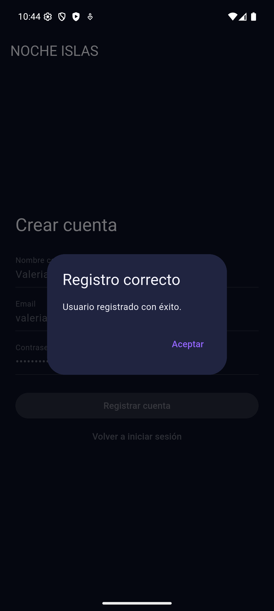
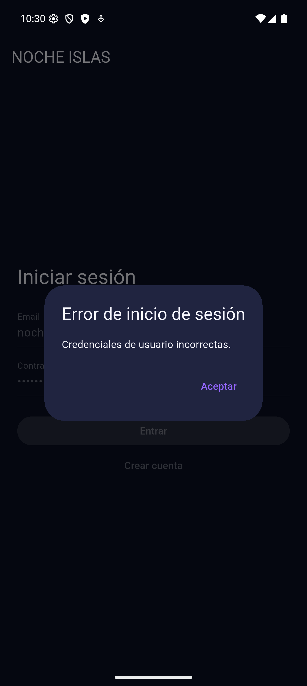
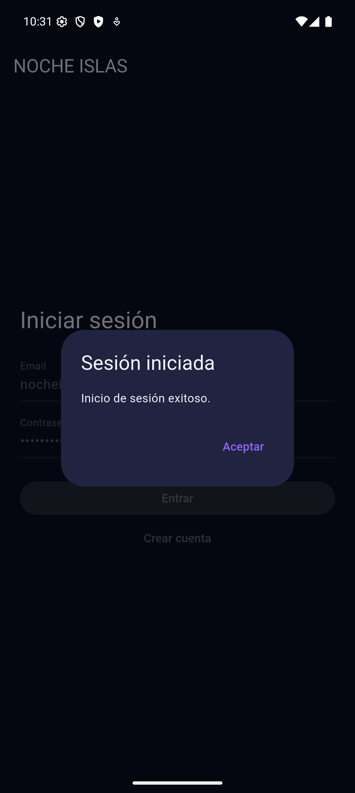
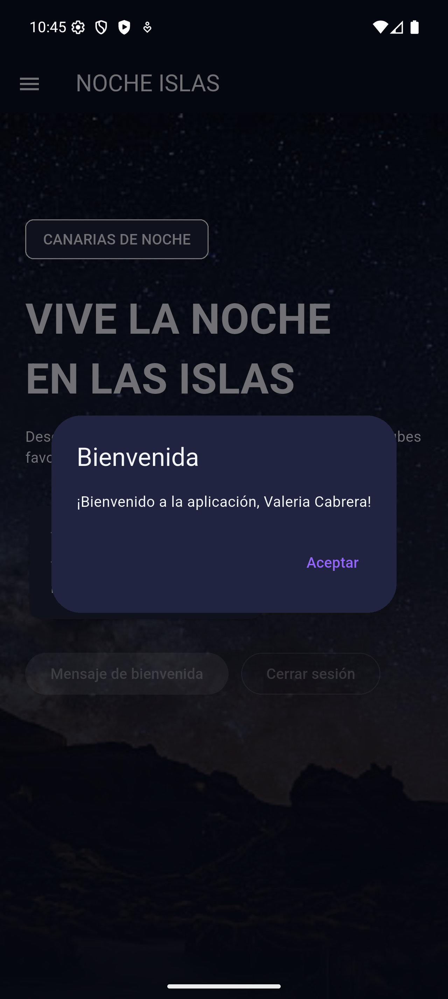

# NocheIslas

Aplicación Flutter sobre el ocio nocturno en Canarias, con un portfolio personal y una lista de elementos.

## Ejecutar la aplicación

```sh
flutter pub get
flutter run
```

## Gestión de sesión

1. Al abrir la app aparece **Iniciar sesión**. Si hay un JWT guardado, se comprueba con `GET /users/check-token`. Una sesión válida abre Inicio automáticamente.
2. Desde **Crear cuenta**, introduce tu nombre completo, un email válido y una contraseña de al menos ocho caracteres con mayúscula, minúscula, número y símbolo. La app enseña la respuesta de la API y vuelve a Iniciar sesión tras confirmar el registro.
3. En **Iniciar sesión**, introduce el email y la contraseña. Tras un acceso correcto, la app guarda el JWT en el almacenamiento seguro del dispositivo y abre Inicio.
4. Desde Inicio, **Mensaje de bienvenida** pide a la API el saludo personalizado y lo muestra en una alerta. **Cerrar sesión** elimina el JWT y vuelve al login.

La app se conecta a [My Users API](https://my-users-api.onrender.com). El servicio HTTP usa JSON para el registro y el login, y envía el JWT en la cabecera `Authorization: Bearer` para validar la sesión y obtener la bienvenida. En Android, el almacenamiento seguro se apoya en Android Keystore. En iOS usa Keychain. [Contrato de los endpoints](https://github.com/adhernea/my-users-api/blob/main/docs/endpoints_api.md)

## Capturas de gestión de sesión

Capturas del emulador Android con una cuenta de prueba de la API.

| Registro exitoso | Login fallido |
| --- | --- |
|  |  |

| Login exitoso | Mensaje de bienvenida |
| --- | --- |
|  |  |

## Portfolio y elementos

El menú de la sesión da acceso al perfil, las aficiones y **Mis elementos**. Los elementos permiten añadir nombre, descripción y categoría, borrar una tarjeta o vaciar la lista tras confirmar. La lista se guarda en memoria mientras su pantalla está abierta.

## Verificación

```sh
flutter analyze
flutter test
```

Las pruebas cubren el registro, el login correcto e incorrecto, la recuperación de sesión, el rechazo de un token caducado, la bienvenida, el cierre de sesión y las pantallas de elementos y portfolio.
