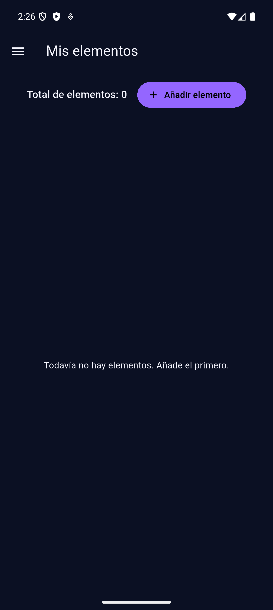
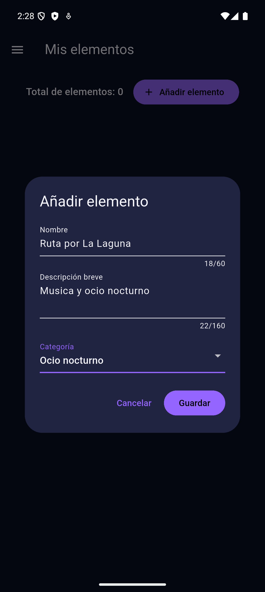
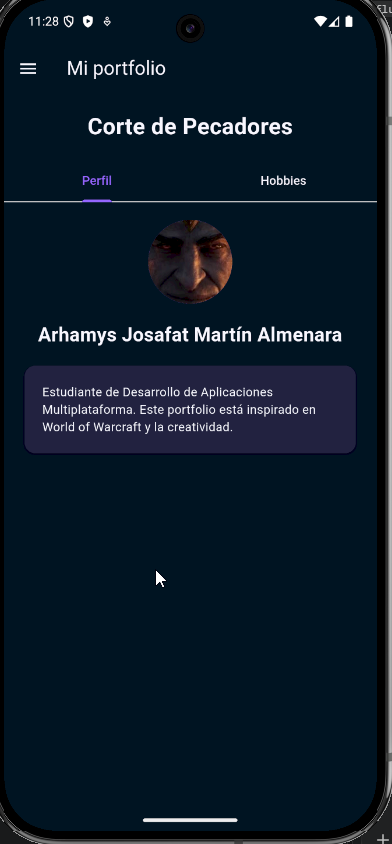
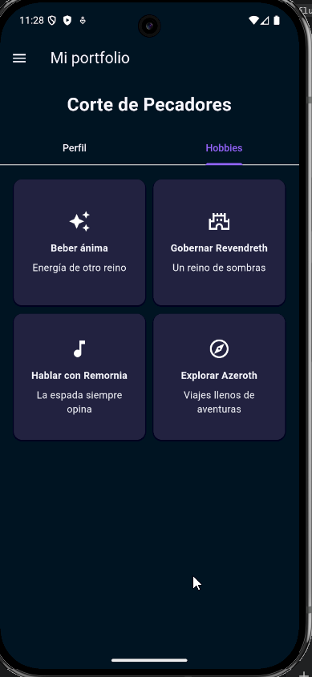

# nocheislas

A new Flutter project.

## CRUD de elementos

Desde el Drawer, abre **Mis elementos**. Puedes añadir elementos con nombre,
descripción breve y categoría y borrarlos. El contador se actualiza
con la lista y cada categoría muestra una imagen local (ocio nocturno o
videojuegos). El formulario valida los campos obligatorios.

El botón **Borrar todos** permite vaciar la lista tras confirmar en un modal.
Cancelar conserva los elementos. El botón se desactiva cuando la lista está vacía.

Los elementos se guardan en memoria mientras la pantalla permanece abierta;
al salir de ella o reiniciar la aplicación la lista se vacía.

Validación: `flutter analyze` y `flutter test`.

## Capturas de pantalla

Capturas de la aplicación funcionando en el emulador Android.

### Elementos: lista vacía

### Formulario para añadir un elemento

### Lista dinámica de elementos

### Inicio

### Perfil

### Hobbies

